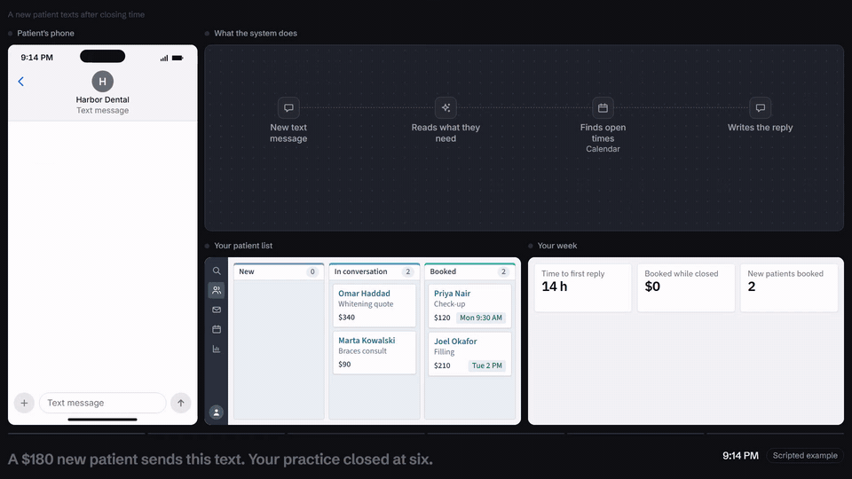

# splitdemo

Demos of automation and AI systems that a business owner can follow. One scripted story plays step by step: a line of text says what is about to happen, then the screen it happens on shows it at full size. The story ends on a results slide that asks the owner a few of their own numbers and shows what the system is worth on them. The same story also plays as a split screen, on up to four app-like screens at once.



The picture shows fast mode, the split screen. A link opens in explainer mode, which tells the same story one screen at a time.

## Why

Most automation demos show the workflow canvas. The person paying for the system does not read canvases. They want to know what their customer sees, where the lead ends up, and what changed in their numbers.

splitdemo tells that as a story in steps. The first card says what is at stake: "A $180 new patient sends this text. Your practice closed at six." The text goes out on the patient's phone. One card and one diagram show what the system does while nobody is at the desk. The screens after that show what came of it: the reply on the phone, the patient on your list, the reply time going from 14 hours to 38 seconds. One screen changes at a time, so there is time to read it.

Fast mode puts the customer's phone, the automation, the CRM and the week's numbers next to each other on one wall, and the same story moves through all of them at once. It is the short version, for a viewer who already knows the story.

## What is in the box

- A demo is one JSON file: the panels, a story in steps, the outcome and the numbers for the calculator. There is no code per demo, so swapping the CRM for a spreadsheet means changing one `type`.
- That one file plays two ways. Explainer shows a card and then one screen at a time, and takes 60 to 100 seconds. Fast shows the whole wall and takes 30 to 50. The switch top left goes between them and keeps the step.
- A results slide closes the story. It shows the outcome numbers next to what they were, then asks the owner up to four of their own numbers, one question a screen. The report works out what the system adds a month and over the first year, and draws it: twelve months against carrying on as today, and a funnel where the business has a pipeline, so the stage that widens shows.
- Nine panels come with it: phone, form, inbox, workflow, CRM board, sheet, calendar, email campaign and a numbers board with a chart. Each looks like the kind of app it stands for, with its own colours and typeface: the sheet has column letters and a formula bar, the CRM has a board with deal cards. A panel takes the tool's name as a label, like "CRM in ClickUp", and carries no logo.
- You can show a demo live on a call from your own machine, send it as a private link, or film it (the story or the wall, 1920x1080, upright for a phone, or a gif).
- The Claude Code skills write a demo from a job post, a process description or a call transcript. They check it and look at every card and every screen before they hand it over.
- Two checks catch a bad demo before a prospect does. One finds an action that cannot happen or a caption that is too long, prints how long each mode plays, and notes a step that asks too much of the viewer. The other finds text that gets cut off or ends in three dots, in both modes, on a laptop or a phone.

Every demo carries a small "Scripted example" tag. Nothing connects to a real system; it is a simulation of what the system will do.

## Start with Claude Code

```
/plugin install splitdemo --marketplace Ramonvdo/splitdemo
/splitdemo-onboarding
/splitdemo <paste a job post, or describe the problem>
```

Onboarding runs once. It installs the app, asks where your demos should live and whether you want links (Cloudflare) or local demos only, and writes `~/.splitdemo/config.json`.

After that:

| Command | What it does |
| --- | --- |
| `/splitdemo <job post or problem>` | Writes the story, picks the panels, builds the demo, checks it and opens it. |
| `/splitdemo <slug> <change>` | Changes a demo you already have. |
| `/splitdemo-share <slug>` | Publishes it under a link nobody can guess, after showing you what goes online. |
| `/splitdemo-video <slug>` | Films it as an mp4: the story step by step, or the wall with `--fast`. `--portrait` is for a phone and `--gif` for a README or an email. |
| `/splitdemo panel <what it shows>` | Adds a panel type for a screen the nine cannot show. |

## Start by hand

Needs Node 22.18 or newer.

```bash
git clone https://github.com/Ramonvdo/splitdemo
cd splitdemo
npm ci
npm run dev
```

Open http://localhost:4310 for the three examples. They open in explainer mode; `?mode=fast` at the end of an address opens the wall. http://localhost:4310/__panels shows every panel on its own.

On a call: the switch top left goes between Explainer and Fast. Space plays and pauses, the arrow keys step through the story, `R` plays it again and `H` hides the bars. In fast mode `1` to `4` enlarge a panel. On the results slide you type the prospect's own numbers into the fields.

## What a demo looks like

```json
{
  "v": 1,
  "title": "A new patient texts after closing time",
  "panels": [
    { "id": "phone", "type": "phone", "label": "Patient's phone", "config": { "contact": "Harbor Dental" } },
    { "id": "crm", "type": "crm", "label": "Your patient list", "config": { "columns": [{ "id": "new", "title": "New" }, { "id": "booked", "title": "Booked" }] } }
  ],
  "beats": [
    {
      "say": "9:14 PM. The practice closed at six. Send the text a new patient would.",
      "wait": "click",
      "do": [{ "on": "phone", "type": "send", "text": "Hi, I chipped a tooth. Can I come in this week?" }]
    },
    {
      "say": "Dana is on your patient list before you have seen her text.",
      "do": [{ "on": "crm", "type": "add", "id": "dana", "to": "new", "title": "Dana Whitfield" }]
    }
  ],
  "outcome": [{ "value": "38 sec", "label": "to first reply", "was": "14 h" }],
  "results": {
    "title": "What a missed message costs",
    "roi": {
      "currency": "USD",
      "inputs": [
        { "id": "texts", "label": "After-hours texts a month", "ask": "How many texts come in after closing, in a month?", "value": 40 },
        { "id": "booked", "label": "Share of those that book a visit", "ask": "Of every 100 of those texts, how many book a visit today?", "value": 10, "kind": "percent" },
        { "id": "visit", "label": "Worth of a first visit", "ask": "What is a first visit worth to you?", "value": 180, "kind": "money" }
      ],
      "lever": { "input": "booked", "add": 20 }
    }
  }
}
```

Each beat is one step: a caption and the actions it brings. In explainer mode the caption is the card, and the actions show one screen at a time in the order they are written. In fast mode they play on the wall while the caption stands under it. Timing follows from the text, so you write no numbers unless you want a pause on the wall. A beat with `"wait": "click"` holds until the viewer presses the button themselves.

`results` is optional. The calculator is one chain of numbers that multiply, and a lever: the one number in the chain the system changes. Here 40 texts × 10% booked × $180 is $720 a month today. With 20 points more booked it is $2,160, so the slide starts at $1,440 extra a month. An input with an `ask` is a question the slide puts to the viewer. The rest are your estimates, and the viewer can change every number in the report.

The full examples are in [`examples/`](examples). The list of panels with their actions is [`src/panels/INDEX.md`](src/panels/INDEX.md), and each panel's folder says how to use it well.

Your own demos live outside this repo, in a workspace folder you choose: `<workspace>/demos/<slug>/demo.json`. That keeps prospect data out of a clone you might push.

## Commands

| Command | What it does |
| --- | --- |
| `npm run dev` | Plays every demo at `http://localhost:4310/<slug>/` and reloads when its file changes. |
| `npm run check -- <slug>` | Says whether the demo can play, where in the file it goes wrong, and how long each mode plays. |
| `npm run shots -- <slug>` | A picture of every card, screen and beat in both modes, and a failure when any text is cut off or shortened. `--mode explainer` or `--mode fast` shoots one. |
| `npm run share -- <slug>` | Publishes the demo to your Cloudflare Worker. `--dry-run` publishes nothing. |
| `npm run export -- <slug>` | Writes the demo as one plain folder for any static host. |
| `npm run record -- <slug>` | Films the story. `--fast` films the wall, `--portrait` and `--gif` as above. Needs ffmpeg. |
| `npm test`, `npm run e2e` | Unit tests, and the browser tests. |

## Sharing

A shared demo gets its own folder under a name like `harbor-dental-x7k2`. There is no index page, a wrong address returns a real 404, and the pages ask search engines to stay out. One prospect's folder holds nothing of another's.

Every link has an end date. A demo is shared for 30 days unless you say otherwise, and it drops out at the next publish after that. `npm run share -- --stop <slug>` takes one offline sooner.

A link opens in explainer mode. The same link with `?mode=fast` at the end opens the wall. With `?q=report` the results slide opens on the report with your example numbers, and offers the questions from there.

By default a share shows you what will go online and waits for a yes. Set `"share": "auto"` in the settings to skip the question.

## Adding a panel

A panel is one folder in `src/panels/` with seven files: a schema, a pure reducer with its tests, a view with its skin, a short guide for the agent and a working example. The app picks it up by name. [`CONTRIBUTING.md`](CONTRIBUTING.md) has the contract.

## License

MIT. The chart components come from [Bklit UI](https://github.com/bklit/bklit-ui), also MIT. See [`THIRD_PARTY_NOTICES.md`](THIRD_PARTY_NOTICES.md).
